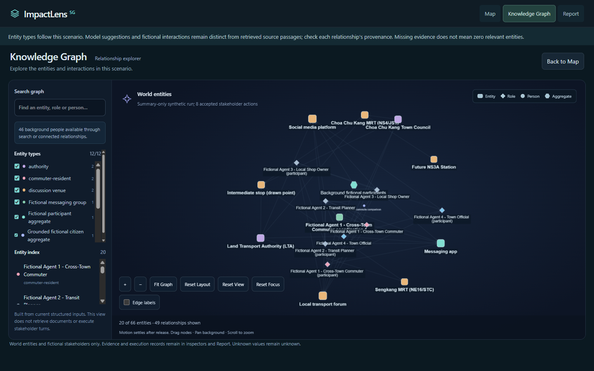
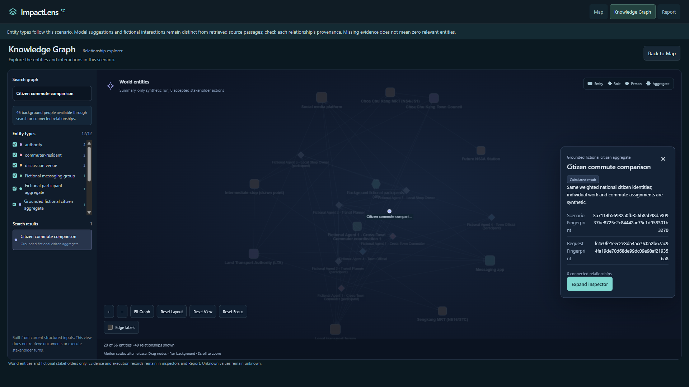

# ImpactLens Knowledge Graph and Report Improvement Research

**Date:** 2 November 2026  
**Audience:** ImpactLens developer and presentation team  
**Scope:** Graph/report research, the approved reduced hackathon implementation, and its completed prototype verification. Broader evidence navigation and narrative synthesis remain future scope.

## Readability repair after user testing

The user correctly identified that the first graph inspector and report still described counters rather than the discussion. The revised inspector leads with a concise explanation or the saved AI narrative for that node; activity totals, classifications, timelines and technical provenance move under **Activity and technical details**. Sources and relationship navigation remain accessible.

The report's single explicit writer request now receives bounded accepted public fictional statements and writes both report sections and known-node summaries. The graph reads that saved artifact with the same run/snapshot identity; clicking a node never starts inference. Private-channel content, memories, profiles and raw source statements are not returned to the browser.

The retained polyclinic run had eight initial statements but zero social AI calls because `SOCIAL_LLM_ENABLED` was missing. Configuration is corrected for future manual runs; the old run is preserved and can receive an initial-views summary. See [repair plan and verification](../docs/READABLE_DISCUSSION_SUMMARIES_PLAN.md). This section supersedes the earlier aggregate-only narrative and metric-first inspector choices below.

## Current hackathon implementation plan

**Status: IMPLEMENTED; prototype smoke verification complete (2 November 2026).** Both visible Codex CLI workers completed their tasks in the same checkout, using `gpt-6.1-sol`, high reasoning effort and the configured fast tier. The retained 50-agent run produced 30 accepted real social decisions; a separately approved fresh report-only attempt succeeded following an interrupted request. Browser checks covered five report sections, saved-summary reuse, WhatsApp/Reddit labels and inspectors, keyboard selection and zoom. Initialization was offline; full V7/citizen-grounded acceptance remains unverified. See [execution results and limitations](../docs/GRAPH_REPORT_PROTOTYPE_ACCEPTANCE.md).

**Goal:** Improve graph labels and the summary shown when clicking a node, and add one AI-written report summary using existing permitted evidence. The broader graph/report research below remains future scope unless included explicitly here.

**Architecture:** Keep Cytoscape, D3, existing graph data and the existing report. Graph descriptions use deterministic templates over current public node fields, with no AI calls on click. One separate server-side writer produces a saved plain-language report summary; it does not change graph topology or simulation behaviour.

The shared implementation contract, proposed report files and detailed smoke-test procedure are in [the current report implementation plan](Report_Display_and_ReportWriter_Research.md#current-hackathon-implementation-plan). This section and that plan supersede the broader priority table below for the prototype.

### Approved prototype scope

| Feature | Include now | Defer |
|---|---|---|
| Graph labels | Concise, understandable display names; retain full names in search/inspector; prioritise selected/search labels over competing overview labels. | A full collision-solving system, new layout/library, new topology, relationship filters and grouped connection redesign. |
| Node summaries | Lead with what the node represents and its useful existing facts. Use short sentences; place hashes and technical provenance below. Preserve distinctions among an entity, fictional participant, scenario role and calculated aggregate. | AI calls per node, invented relevance/relationships, extra private facts and a full inspector redesign. |
| Report | One AI-written summary above the existing report, with Findings, Agreements, Disagreements, Concerns and Unknowns. Save and reuse the result for unchanged inputs. | Six-chapter rebuild, advanced charts, exports, report-to-graph evidence links and elaborate generation progress. |
| Evidence | Reuse permitted existing fields and existing access/privacy controls; use explicit insufficient-information wording when needed. | Dedicated evidence checking, citations, semantic claim validation, a new consensus scorer or content-extraction pipeline. |

The graph must retain its canonical IDs, original labels/data, searchability, force inputs, camera/selection lifecycle and drag behaviour. Never rename an unspecified “Messaging app” as a particular real service without existing support. A friendly node summary must not strengthen an assumption into a fact or describe fictional activity as observed public behaviour.

**User-requested naming fix during implementation:** latest entity generation now provides concrete communication-service choices: WhatsApp/Telegram for private messaging, Instagram for public feeds and Reddit for public discussion. Generic service placeholders are rejected for new communication declarations. These choices are explicitly fictional scenario setup. Historical “Messaging app” records are preserved rather than falsely retroactively identifying a service. The change is in `lib/server/inference/named-communication.ts` and the latest entity planner; historical schemas/replay are unchanged. Offline named-service and graph propagation tests pass; real provider acceptance of the expanded planner schema is a separate unverified qualification.

### Worker ownership: same checkout, no worktrees

Execution used **two visible Codex CLI processes in this repository**, with the configured model and normal sandbox/approval settings. No separate worktrees, branch creation or merge step. Both workers have completed.

| Owner | Exclusive write scope | Result |
|---|---|---|
| **CLI worker A: graph** | `lib/knowledge-graph/display.ts`, `lib/knowledge-graph/renderer.ts`, `components/knowledge-workspace.tsx`, `components/knowledge-workspace.css`, new `lib/knowledge-graph/node-summary.ts`, graph-specific focused tests. | Clearer display labels and useful deterministic node summaries. |
| **CLI worker B: report** | `components/communication-report.tsx`; new `components/report-ai-summary.tsx`, `components/report-ai-summary.css`, `lib/report-summary/contract.ts`, `lib/server/report-summary.ts`, `app/api/reports/summary/route.ts`; report-specific focused tests. | One bounded summary call, simple UI/error handling and snapshot-bound saved output. |
| **Main coordinator** | The two plan documents, task notes, and only necessary shared-file integration changes after explicit ownership transfer. | Review combined changes, run shared checks and own the one capped real-inference test. |

Each worker may use one scoped subagent when useful. Prefer read-only investigation or focused review; an editing helper needs exclusive ownership of a subset of its parent's files. Parent and helper must not edit the same file concurrently. Helpers may not modify the other worker's files, create worktrees, launch paid tests or recursively expand the task.

Preserve all pre-existing dirty/untracked work, especially the ongoing inference admission/timeout repair, test guards and acceptance evidence. Read `AGENTS.md` and relevant installed Next.js guides before writing code. Workers report required shared-file changes to the coordinator rather than editing them independently. Avoid competing builds/dev servers and do not commit, stage, reset, clean or revert unrelated work.

### Graph worker tasks

- [x] Inspect existing display-label helpers, renderer label-density rules and selected-node inspector content.
- [x] Add a deterministic node-summary helper using permitted fields, with no network or inference calls on selection.
- [x] Apply concise display labels and selected/search priority; retain canonical names, IDs, physics and graph records.
- [x] Place the plain-language summary before technical identifiers/provenance; retain details and keyboard behaviour.
- [x] Run focused graph checks and combined planner/report checks; inspect named-service propagation and the live browser result.

Worker B separately implements the report contract in the linked plan. The prototype intentionally omits a per-claim evidence validator. Basic response-shape/error handling and existing authentication/privacy rules remain. Existing aggregate counts alone cannot establish substantive agreement; the summary must acknowledge when permitted content is insufficient.

### One combined real-inference smoke test

After implementation is requested and both workers finish, use **one fresh 50-agent simulation capped at 30 social AI decision attempts**, then **one separate report-generation call**. Planning, initial actions, personalities and retrieval remain separate startup work included in the test's overall spending/accounting limits. The cap does not promise 30 accepted choices or participation by every agent. Configure it through task-local admission, not changes to the production scheduler or normal capacity.

The main coordinator runs required focused/mock checks first, then inspects both features against the same retained test result: read the five report sections, check representative node labels/summaries and normal graph interactions, and reopen the saved report to verify no extra writer call. Allow **15–25 minutes for the combined smoke test, excluding fixes**. This is prototype acceptance, not a full behavioural, security or performance evaluation. Do not automatically retry timed-out paid calls or reuse a closed live-test authority.

**Follow-up checks reuse the same retained 30-decision-cap run.** After label, node-summary or report-display fixes, reopen that snapshot rather than clicking Explore again or resuming its simulation. Reuse the saved report for display-only fixes; no inference is needed. If the report prompt or generation logic changes, test with mocks first and, if required within a separately authorised report-call budget, generate only a new summary from the same simulation. Version or invalidate the derived summary so stale cached prose does not masquerade as a test of the changed writer. Preserve the underlying run and previous evidence; do not reopen closed paid-run authority.

Follow-up presentation checks are estimated at **5–10 minutes**, excluding fixes or a new writer call. A new social simulation is needed only when relevant scenario or simulation behaviour changes; such changes are outside this prototype. See [the report plan's retained-run procedure](Report_Display_and_ReportWriter_Research.md#reuse-the-retained-run-after-fixes).

**Original planning allowance:** roughly **90–120 minutes for a smooth parallel prototype plus the combined test; up to three hours for fixes**. Initial parallel worker implementations took about seven minutes; that excludes integration, full checks/builds, the naming fix and live/browser verification. The successful fresh report request itself took about 18 seconds. These measured pieces are not an end-to-end simulation performance benchmark.

## Executive recommendation

Keep the current Cytoscape renderer and D3 force engine. The strongest immediate improvement is to make the graph explain its existing records more clearly, then connect those records to a shorter, better organised Report.

The graph already provides search, entity-type filters, background-person discovery, selection highlighting, camera focus and several inspector sizes. Its main weaknesses are overlapping labels, ambiguous role and participant identities, generic communication nodes such as “Messaging app” that do not identify a service, relationship meanings that require too much inspection, and a calculated commute aggregate that has no graph connections. Adding another graph library would not resolve those information-design problems. [Local graph implementation](../components/knowledge-workspace.tsx), [renderer](../lib/knowledge-graph/renderer.ts), [commute graph adapter](../lib/citizen-grounding/graph.ts).

Prioritise these changes:

1. **Initial readability:** give labels a clear priority, retain the existing entity/role/person/aggregate hierarchy, and reduce competing relationship marks without hiding their existence.
2. **Exploration:** improve the selected entity's connection list, explain direction and evidence status in plain language, and make hidden connections discoverable.
3. **Evidence navigation:** let a report finding open its exact entity or relationship in the same retained run, with a reliable return to the finding.
4. **Informative report:** answer the original question in everyday language, then explain calculated effects, areas of agreement, disagreements, practical concerns, developments and unresolved questions. Keep technical metrics as supporting detail.
5. **Bounded narrative writer:** build a permitted, content-preserving evidence projection and a small ReportWriter to synthesise those findings. Validate references and retain server-owned numbers. Reorganising aggregate counts alone is an intermediate improvement, not the complete report experience.

MiroFish provides useful presentation patterns, but its report agent is a substantially larger generation system. Adopt selected interface ideas first; defer autonomous research and simulated-agent interviews.

The report-specific recommendations, plain-language examples and narrative evidence requirements are developed in [Report Display and ReportWriter Research](Report_Display_and_ReportWriter_Research.md). Both documents recommend an informative account of findings, rather than a technical activity log with improved formatting.

## Evidence baseline and interpretation

The review covers all eight images in [the supplied evidence folder](../docs/evidence/geographic-selection-v7-20261102), the associated [integrated acceptance record](../docs/GEOGRAPHIC_SELECTION_V7_REAL_PROVIDER_INTEGRATED_ACCEPTANCE.md), and the current graph and report source at checkout HEAD `58bd4ea`. The working tree includes later local work. Recommendations should be checked against the current source when implementation starts.

The screenshots establish appearance at two desktop sizes. Source inspection establishes how the current controls and projections work. The acceptance record establishes the retained run's execution and numerical accounting. This is a source and screenshot review, not a new usability study or live-provider evaluation.

| Evidence | What it establishes | Implication |
|---|---|---|
| Graph overviews at 1440 × 900 and 1920 × 1080 | The footer shows 20 of 66 entities and 49 visible relationships. The centre contains overlapping role, participant and group labels. | A modest visible graph still needs better label selection and identity cues. |
| Generic communication nodes in the overview | “Messaging app,” “Social media platform” and “Local transport forum” describe categories without establishing which service or forum they represent. | Distinguish named hypothetical services, fictional venues and deliberately unspecified communication environments. |
| Commute graph captures at both sizes | Searching selects “Citizen commute comparison”; its compact inspector displays fingerprints and “0 connected relationships.” | Finding the calculation does not yet explain its relationship to the scenario or report. |
| Four full-page Report captures | Assumptions, population metrics, chronology, cohort metrics and repeated venue details occupy a long page. | Much of the required content already exists; reorganising it can deliver value without new inference. |
| Integrated acceptance record | The retained graph contains 66 nodes and 307 edges. Initialisation produced eight accepted stakeholder actions; the first social opportunity timed out at tick 1 of 320, with zero accepted social decisions. | The interface must distinguish initialisation from social execution and describe this as an interrupted prefix. |

The difference between 49 displayed relationships and 307 retained edges is a presentation distinction. It is not evidence that records were lost. Forty-six background people are discoverable through the existing search and relationship mechanisms. [Acceptance record](../docs/GEOGRAPHIC_SELECTION_V7_REAL_PROVIDER_INTEGRATED_ACCEPTANCE.md), [visibility selector](../lib/knowledge-graph/societal-presentation.ts).

### Current overview

The hierarchy already distinguishes shapes. The problem is that too many long labels compete in the same region, while the relationship lines provide little readable meaning at this scale.

### Current commute inspection

The selected calculation needs a useful summary and an evidence destination before technical identity details.

## What the current implementation explains

### Readability rules miss this graph size

`GraphRenderer.updateLabelDensity()` suppresses ordinary person labels only when at least 100 nodes are visible and zoom is below 0.8. Entity, role and aggregate labels receive special treatment that keeps them legible as the camera zooms out. The current capture contains only 20 visible entities, so that density condition does not address its central collisions. Legible individual labels can still overlap as a group. [Renderer](../lib/knowledge-graph/renderer.ts).

The edge-label density condition checks the total core edge count, rather than the count currently displayed. Its interaction with the retained 307 edges and visible 49 deserves a regression case. A label policy should follow the current viewport and selection, rather than assume that total graph size alone predicts clutter.

### Similar labels represent different identities

The server deliberately retains scenario roles and fictional participants separately. `entityFirstGraph()` adds a participant suffix and can connect a participant to its role through `REPRESENTS_FICTIONAL_SCENARIO_ROLE`. Similar-looking nodes are therefore not automatically duplicate data. Merging them by label would discard a meaningful distinction. [Entity graph projection](../lib/server/society/entity-graph.ts).

The correct change is to clarify the displayed identity and expose the binding. For example, a short role label and a participant label can share the same readable role name while showing different type cues. Canonical labels and IDs should remain available in the inspector.

### The commute aggregate really is disconnected

`appendCitizenCommuteGraph()` adds a node containing the calculation's identities and public metrics. It preserves existing edges and adds no new ones. The zero-connection inspector is therefore consistent with this adapter; it is not sufficient evidence of a selection bug. [Commute graph adapter](../lib/citizen-grounding/graph.ts).

The adapter also does not assign the `presentationCategory` used for the renderer's aggregate shape. This explains why the calculated aggregate appears as a small circle despite its aggregate entity type. A presentation rule keyed to its registered record type can make that classification consistent without rewriting historical records.

### Inspectors and navigation already provide a foundation

The full inspector already lists connected relationships, allows navigation to the other endpoint, and provides a separate relationship-inspection action. Selection already highlights the immediate neighborhood. Search already includes safe background candidates and can restore a filtered entity type when a result is selected. These should be refined, not rebuilt. [Knowledge workspace](../components/knowledge-workspace.tsx), [selectors](../lib/knowledge-graph/selectors.ts).

The current `CommunicationReport` has no general callback for opening a finding's graph reference. `KnowledgeWorkspace` accepts `focusAgentId`, but the application needs a run-bound target for any eligible node or edge. The main public-run report is rendered through `CommunicationReport`; the separate `QuestionReportV1` projector is useful reference material, but changing it alone would not reorganise the screen in these captures. [Workspace integration](../components/workspace.tsx), [communication report](../components/communication-report.tsx), [question report contract](../lib/question-simulation/report.ts).

## Lessons from MiroFish

### Graph presentation

MiroFish's inspected `GraphPanel.vue` uses D3 with an SVG surface. It draws type-coloured circles, truncates node labels, highlights a selected node and its incident edges, and opens a detail panel. Relationship details present source, relation and target alongside the recorded fact. It also provides optional edge labels, separates parallel relationships with curves, and groups self-relations for inspection. [MiroFish GraphPanel source](https://github.com/666ghj/MiroFish/blob/main/frontend/src/components/GraphPanel.vue).

These are useful interaction references, not evidence that its graph is more usable for ImpactLens. ImpactLens already has neighborhood highlighting, parallel-edge rendering and richer role/person/aggregate shapes. Retain those strengths. Borrow the concise relationship sentence and inspectable grouping; avoid copying its short fixed label truncation or replacing ImpactLens's existing engine.

### Report generation and interface

MiroFish's `ReportAgent` plans an outline and generates chapters through iterative tool use. Its tools include several retrieval methods and simulated-agent interviews. The inspected source sets a maximum of five tool calls per section and defines reflection controls. This is a tool-using generation workflow, with more execution and validation responsibilities than a single narrative call. [MiroFish ReportAgent source](https://github.com/666ghj/MiroFish/blob/main/backend/app/services/report_agent.py).

Its report interface displays numbered chapters, collapse controls for completed sections, generation states and workflow progress. These presentation ideas can be adopted independently of its agent backend. [MiroFish report interface](https://github.com/666ghj/MiroFish/blob/main/frontend/src/components/Step4Report.vue).

For ImpactLens, use chapter navigation immediately. Show generation progress only when an actual writer job exists. An instantly rendered deterministic report does not need a simulated generation sequence. Keep fictional activity labelled as fictional throughout.

The external comparison uses the linked `main` source views consulted on 2 November 2026. Those links can change; it is not a pinned upstream release audit or a side-by-side usability benchmark.

## Improve initial readability

### Select labels according to the current view

Use a deterministic label priority: selected item, keyboard-focused or hovered item, active search match, immediate context, then remaining labels. Preserve full canonical text in the index and inspector.

At overview scale, show concise names for scenario entities and roles where they fit. Hide colliding lower-priority labels while keeping their nodes visible and selectable. At closer zoom, reveal more labels. For a selection, guarantee the selected label and show as many neighbor labels as can fit; the relationship list must carry any remaining names.

A first implementation can rank rendered label boxes and suppress collisions, with a small screen-space margin. Recalculate after camera changes or when layout has settled, using throttled rendering work. Do not solve text collisions by moving nodes, changing forces or running a second layout. This preserves the user's spatial context.

This applies the established overview, filtering and details-on-demand approach to the actual viewport. It is a design hypothesis to test, not proof that a particular label budget is optimal. [Shneiderman's original visualisation paper](https://www.cs.umd.edu/~ben/papers/Shneiderman1996eyes.pdf). Cytoscape already supports label, class and style control within the current renderer. [Cytoscape documentation](https://js.cytoscape.org/#style/labels).

### Keep three visual meanings separate

| Visual cue | Meaning | Proposed treatment |
|---|---|---|
| Shape | Entity, role, person or aggregate | Keep the existing shape hierarchy; render the registered commute aggregate consistently. |
| Colour | Entity type | Keep stable mappings and a readable legend. Do not reuse the same colours to imply evidence certainty. |
| Badge and relationship style | Evidence or execution status | Use explicit text such as “Calculated,” “Proposed,” “Assumed tie,” or “Recorded fictional interaction.” |

Make the selected item the strongest visual element. Avoid scaling nodes as a general measure of importance: degree and activity are not evidence quality or real-world influence. Keep role and participant identities distinct, and preserve the current recorded-significance rule for background people.

Colours must have accompanying text or shape cues. Required graphical information and focus indicators need sufficient contrast; WCAG's non-text contrast guidance specifies 3:1 against adjacent colours for covered elements. Avoid dimming actionable neighbors so heavily that their identities become unreadable. [W3C use-of-colour guidance](https://www.w3.org/WAI/WCAG22/Understanding/use-of-color.html), [W3C non-text contrast guidance](https://www.w3.org/WAI/WCAG22/Understanding/non-text-contrast.html).

### Give communication nodes specific identities

“Messaging app” does not answer which app the scenario assumes, why it is relevant, or whether the node represents a service or a particular group. This is an identity problem as well as a labelling problem. The screenshot does not establish that the service is WhatsApp, Telegram or anything else.

The communication selector preserves the accepted entity's name. It recognises names including WhatsApp and Telegram, but also admits generic environments through declared communication styles or entity types. An unrecognised private messaging environment can use a generic private-group adapter; that implementation does not establish a brand. [Communication selection](../lib/society/communication.ts). The graph projection then reuses the associated entity or its retained channel name. [Entity graph projection](../lib/server/society/entity-graph.ts).

Use the following naming policy:

| What the accepted scenario establishes | Proposed graph label | What the inspector must explain |
|---|---|---|
| An explicitly named service, such as WhatsApp | **WhatsApp (simulated)** | Who supplied or proposed that choice, what role it serves, and that no real accounts or platform activity are involved. |
| A hypothetical service selected by the model | **Telegram (scenario assumption)**, if Telegram was actually selected | The service choice is an unverified scenario assumption. Naming it does not verify its use by the represented people. |
| A generic private messaging environment with no named service | **Private messaging — service unspecified** | The service was not specified; the environment uses generic private-group behaviour. |
| A fictional discussion venue about the drawn connection | **Cross-town MRT discussion forum (fictional)**, when that purpose is supported | The topic, intended audience and public/private setting; no existing real forum is implied. |
| A particular fictional coordination group | The group's retained name, with a **Fictional group** type cue | Its purpose and parent messaging environment, separately from the service identity. |

These are proposed display examples, not new identities inferred for the retained run. Use the generic private-messaging label only when its accepted communication style is private-group; otherwise use “Messaging environment — service unspecified.” Apply the same rule to “Social media platform”: name the accepted service, or explicitly state “Social feed — service unspecified” when the feed capability is established.

For new scenario preparation, validate that every communication entity is identified as a named service, a fictional venue with a clear purpose, or an explicitly unspecified environment. When a specific service matters to the question, resolve that choice through the scenario interpretation and evidence process before execution. If the service does not affect the modelled behaviour, an honestly unspecified environment is adequate. Do not invent a brand merely to make the graph look concrete.

The inspector should show the service or unspecified status, venue purpose, communication visibility, identity provenance and permitted activity summary before technical fields. Distinguish “this fictional group uses this messaging environment” from “these people use this real service.” Keep internal adapter names in technical details, while explaining any meaningful modelling limitation in plain language.

For the existing archived run, improve the display and disclose the unspecified service without changing its entity ID, channel configuration or accepted history. Keep the original label available under provenance. Use the same resolved display name in Graph, Report and search results so users can follow the entity consistently.

### Reduce relationship competition without erasing meaning

Keep global edge labels off by default. Show the selected relationship's label automatically, and reveal incident labels selectively when space allows. Background links can be subdued; selected links and their direction must remain clear.

Add a relationship filter alongside the existing entity-type filter. Group the current labels into understandable families: role bindings, proposed relationships, assumed social ties, fictional participation, and recorded fictional interactions. Derive these families from known record types and labels, with a fallback for unfamiliar historical labels.

When several relationships share endpoints, retain their original IDs. A list entry such as “3 relationships between these entities” can expand into the individual records. Do not combine an assumed tie and a recorded interaction into one apparently verified relationship. Grouping belongs in the presentation, not in a rewritten graph or force network.

### Explain what is visible

Preserve the current background-person notice and improve the footer to distinguish visible and retained records: for this capture, “20 of 66 entities visible; 49 of 307 relationships visible.” After filtering, update both counts and expose the active filters.

Show “connections hidden by filters” separately from “no connections recorded.” The current visibility selector limits query reveals and neighbor expansion, so a successful search or selection does not necessarily display every candidate. Offer a bounded “Show more” action and retain the complete eligible connection list. [Visibility selector](../lib/knowledge-graph/societal-presentation.ts).

The background aggregate has fixed membership in its projection. Revealing one of its candidate people must not reduce the aggregate or add that person again to report totals. Surface that count scope in the aggregate inspector. [Entity graph projection](../lib/server/society/entity-graph.ts).

## Improve exploration and relationship meaning

### Put useful content first in the inspector

Use this order in the compact inspector:

1. Name, identity type and evidence status.
2. One short explanation of relevance to this scenario.
3. The most useful permitted metrics or connection groups.
4. “View related report finding” and “Explore connections,” where available.
5. Expandable provenance, assumptions and technical identifiers.

For “Citizen commute comparison,” lead with the mean saving and its denominator, coverage counts and a link to the calculated-impact chapter. Move scenario and request fingerprints into a “Technical identity” disclosure with a copy action. Those fingerprints remain valuable for reconciliation, but they are poor primary content.

Make the relationship list available in the ordinary expanded inspector, rather than requiring a full-window view to understand it. Separate incoming, outgoing and undirected connections. For an incoming edge, preserve the original source-to-target sentence; do not reverse the predicate merely because the target is selected.

### Describe a relationship as a claim with support

Every relationship row should answer: who is connected, how, in which direction, and what supports that statement.

| Existing relationship | Suggested readable label | Meaning to preserve |
|---|---|---|
| `REPRESENTS_FICTIONAL_SCENARIO_ROLE` | Represents fictional scenario role | An explicit simulation binding; no real employment or authority is established. |
| `ASSUMED_SOCIAL_TIE` | Assumed fictional social connection | A network assumption, not an observed relationship. |
| `SIMULATED_PARTICIPATION` | Recorded activity in fictional venue | Activity in an internal environment, not a real platform account. |
| `RECORDED_PUBLIC_INTERACTION` | Recorded fictional public interaction | A retained simulation record; not measured public behaviour. |
| A source-reported relationship | Source reports this relationship | A literal attributed statement; independent corroboration remains separate. |

Retain the raw relationship identifier under details. A friendly label must not strengthen the claim. The inspector should keep description, provenance and any permitted source passage together. A document mentioning two entities is not sufficient evidence that their proposed relationship is true. Existing attribution logic already distinguishes these cases. [World projection and inspections](../lib/world-graph/projection.ts).

### Preserve orientation while exploring

Build on the existing neighborhood highlighting. Offer an explicit “Only this entity and its connections” view for dense neighborhoods, then a clear return to the overview. Keep a short navigation history so users can move from participant to role to venue and back.

Selection should reveal context in the same graph instance. Restore the camera and filters when returning from the Report. Do not use “Reset Layout” as an ordinary exploration action; retain it as a deliberate user control separate from Fit Graph and clearing selection.

Provide the same exploration through keyboard-operable entity and relationship lists. Full names and meaningful relationship text must remain usable without hovering over a canvas mark. On narrower screens, use a drawer or stacked inspector so the details do not obscure the selected entity.

## Connect findings to graph evidence

### Add a reference index outside the graph topology

Create a deterministic reference index connecting report finding IDs to existing eligible graph node IDs, edge IDs and public evidence records. Bind it to the exact scenario, retained execution and evidence snapshot. This is navigation metadata, not a new claim-bearing edge.

| Report content | Appropriate destination | Fallback |
|---|---|---|
| Commute calculation | The matching commute aggregate, plus its calculation evidence panel | Open calculation evidence if the graph node is absent. |
| Statement about a proposed relationship | The exact relationship and its two endpoints | Explain that the relationship is unavailable in this retained projection. |
| Fictional venue activity | The venue node and its permitted aggregate summary | Open the report evidence block without exposing private activity. |
| Source-supported statement | The existing inspected entity or relationship and its attributed passage | Open the source evidence block; do not manufacture a graph relationship. |
| Execution failure or accounting | The relevant report evidence section | Some findings have no graph destination, and should not be forced into one. |

The commute node can link to its report calculation even while it has zero graph edges. If explicit calculation-lineage edges are later needed, derive them only from validated scenario/calculation bindings and mark them as lineage. Adding edges changes the force input, so it belongs in a separate proposal after the presentation work.

### Make navigation exact and reversible

For “View in Knowledge Graph”:

1. Resolve the finding against the retained report's identity and reference index.
2. Open that run's graph, rather than whichever scenario is currently on the Map.
3. Reveal the target and necessary endpoints, including temporarily overridden filters with a visible explanation.
4. Select the node or edge and open the relevant inspector section.
5. Provide “Back to finding,” restoring the Report chapter, scroll position and focus.

A missing or stale reference must produce an honest unavailable state. Do not fall back to a similarly named entity from another run. Never resolve identity by display-label matching. Historical records with incomplete references should keep their report evidence accessible without starting new inference or regenerating a simulation.

The reference index should contain only approved public identifiers and summaries. Existing contracts keep raw conversations and memory server-side; this feature must preserve that boundary. Private-group membership counts do not authorise exposing a membership list. [Public summary contract](../lib/society/public-contract.ts), [discussion summary component](../components/discussion-summary.tsx).

## Reorganise the application Report

Use the following six chapters for this MRT scenario. The first chapter answers the user's question; later chapters explain what changed, where fictional participants agreed or disagreed, and what remains unknown. Use everyday wording in the interface. Larger text and collapsible chapters help navigation, but cannot replace explanation of the findings.

| Chapter | Content | Initial presentation |
|---|---|---|
| **1. What we found** | Original question, plain-language answer, principal calculated finding, discussion outcome and material caveats | Open; explain the result before presenting supporting counts. |
| **2. What we tested** | Drawn alignment, explicit stops, assumed train timings and fictional residents/workplaces | Concise explanation, with full assumptions expandable. |
| **3. How journeys could change** | Explain calculated journey changes and who could be assessed; separate the full population model from the selected discussion participants | Open explanation; labelled tables and weighting details beneath it. |
| **4. What participants agreed on and questioned** | Evidence-backed agreement, disagreement, main concerns, conditions, replies and developments; distinguish setup from later discussion | Short narrative findings first; repetitive venue statistics in optional details. |
| **5. What we still do not know** | Unresolved concerns, interrupted execution, missing evidence and what the model cannot establish | Keep material limitations visible. |
| **6. How we reached these findings** | Evidence references, metric definitions, sources, selection, chronology, AI usage/cost and technical identities | Optional technical detail with stable anchors. |

For non-commuting scenarios, adapt chapter 3 to the available calculation and explicitly mark unavailable capabilities. Do not imply that every scenario has a commuting result.

Add a chapter index, stable finding anchors and selective expand/collapse controls. Keep findings, completion status and important caveats visible without opening audit disclosures. Consolidate repeated explanations of venue classifications into methodology. Existing `DiscussionSummary` and public aggregate fields support a clearer foundation, but cannot explain the actual meaning of concerns, replies or agreement on their own. [Communication report](../components/communication-report.tsx), [discussion summary](../components/discussion-summary.tsx).

### Explain agreement and disagreement, not just activity

The intended MiroFish-like quality is an informative narrative. A reader should be able to say what the main finding was, what fictional participants agreed on, why their views differed, what conditions they attached and what remained unresolved. The main report should not require understanding “LLM-capable agents,” “expansion weight,” “classified decisions” or “inference accounting.” Explain unavoidable terms at first use and move implementation counters to optional details.

For each discussion finding, provide a short headline, a few sentences of explanation, the scope of the participants represented and an evidence action. Cover areas of agreement, disagreements, practical concerns, conditional support, changes following replies and unresolved questions. Do not fill an empty subsection with plausible invented discussion.

Consensus requires agreement on a specific point, with sufficient evidence from distinct participating fictional actors. Multiple posts by one actor, supportive tags, an issue marked closed or silence from other actors do not establish consensus. Conditional agreement must retain the conditions, and contrary evidence must remain visible. If the evidence is too sparse, say that agreement could not be assessed.

The existing public discussion contract exposes counts and classifications, not message text or substantive issue histories. Add a server-side projection of permitted content summaries, positions, reasons, conditions, replies and conflicting evidence before asking a writer to summarise discussion meaning. Keep raw conversations, memory and private membership histories server-side. Internal actor references can prevent duplicate counting without disclosing private identities. [Discussion contract](../lib/society/discussion-contract.ts), [server fact aggregation](../lib/server/society/facts.ts).

### Example executive findings for the supplied run

The following is an example of truthful presentation using the retained acceptance record:

> **What we found:** The proposed MRT connection produced faster calculated journeys for 4 of the 10,000 fictional resident profiles. Many profiles did not have a journey that could be compared, so this does not tell us how all Singapore commuters would be affected. The calculation uses assumed workplaces and train timings, rather than observed journeys.
>
> **What did participants agree on?** We cannot assess agreement from this run. The initial setup produced eight fictional stakeholder actions, but the discussion stopped when an AI request took too long. No follow-up AI choices were recorded.
>
> **What remains unknown?** This run does not show whether participants would agree on the proposal, resolve practical concerns, adjust work schedules or coordinate over the following days.

In supporting calculation details, retain the mean saving of approximately 0.16 minutes, the comparable rail denominator of approximately 205,908.33 in expansion weight, and the improved profiles' expansion weight of 2,115. Explain what each means. The selected discussion cohort contains 50 agents, with 4 selected for calculated impact, 12 for proximity and 34 for broader comparison. Its commute statuses are 4 improved, 2 unchanged, 17 unknown and 27 not applicable. These are different populations for different purposes: the selected cohort must not reweight the whole-population calculation. [Integrated acceptance record](../docs/GEOGRAPHIC_SELECTION_V7_REAL_PROVIDER_INTEGRATED_ACCEPTANCE.md).

### Show stage accounting without conflating outcomes

Use separate rows for planning, stakeholder initialisation, personality initialisation and social execution. The acceptance record identifies 11 returned completions: two planning, eight stakeholder actions and one personality batch. It separately records an interrupted social reservation with no returned response. Presenting only “8 accepted actions” risks making preparation look like completed social behaviour.

Keep reported cost, uncertain reservations and unavailable usage separate. Do not turn a timeout into a rejected prose response, and do not report an acceptance percentage when no social response returned. Existing initial inference accounting and society usage cover different stages; do not sum them blindly or silently treat missing values as zero. [Acceptance accounting](../docs/GEOGRAPHIC_SELECTION_V7_REAL_PROVIDER_INTEGRATED_ACCEPTANCE.md), [public report fields](../lib/society/public-contract.ts).

In chapter 4, this run should explain “The discussion stopped before any follow-up AI choices were recorded, so agreement and later developments could not be assessed.” Initial stakeholder records can still appear separately with their own provenance and permitted summaries. Quiet later periods and absent follow-ups are not evidence that stakeholders had no concerns.

## Build a bounded ReportWriter for narrative findings

### Keep evidence assembly deterministic

The proposed sequence is: retain an evidence snapshot, assemble an allowlisted evidence pack preserving permitted discussion meaning, generate narrative once, validate the output, then render findings with deterministic metrics and evidence references. The bounded writer is part of the recommended informative report; the reorganised deterministic report remains its foundation and fallback.

“Approved evidence pack” means records admitted through the application's evidence, identity and privacy rules. It does not require introducing another manual approval screen. The pack should contain only material relevant to the six chapters, within a fixed size budget.

| Evidence-pack field | Purpose |
|---|---|
| Exact question, scenario identity and immutable snapshot binding | Keep the narrative attached to the right hypothetical scenario and retained prefix. |
| Execution status and coverage | Prevent a failed or partial run from being described as completed. |
| Metric IDs, values, units and denominators | Supply authoritative numbers and distinguish cohort from population. |
| Permitted discussion content summaries, positions, reasons, conditions, replies and contrary evidence | Support meaningful agreement/disagreement and development summaries; classifications and participation counts provide coverage context. |
| Source and evidence IDs with permitted passages | Support traceable attribution without treating arbitrary retrieved text as instructions. |
| Material assumptions, unknowns and limitations | Preserve the scope of every conclusion. |
| Finding-to-graph reference index | Supply validated destinations rather than model-invented graph IDs. |

Do not send the entire internal world, personality profiles, private dialogue, session tokens or filesystem metadata to the writer. A source passage's availability in storage does not automatically make it appropriate for the narrative pack.

### Constrain the writer output

Start with a fixed six-chapter template and one bounded structured-output call per immutable evidence snapshot. The model should explain supplied facts, summarise specific agreement and disagreement, retain conditions and concerns, describe supported developments and identify unknowns. Counts alone are insufficient for this task. It should not retrieve new sources, interview agents, run calculations or mutate the simulation.

Return short narrative blocks with evidence IDs and metric placeholders. The server resolves placeholders to formatted values and units. Citation labels and graph destinations also come from validated reference records. For example, the model may request the mean-saving metric; it cannot supply a replacement value or denominator.

Validate section IDs, output size, permitted references, metric scope and evidence classification. Require each substantive block to reference suitable evidence, and reject invented quotations or unsupported named entities. Render numerical findings, status banners and material limitations deterministically even when narrative is present.

Reference validation proves that the records exist; it does not prove that generated prose follows from them. Reduce that risk with short, constrained blocks, explicit evidence classes, deterministic status rules and evaluation against failed, partial and conflicting-evidence fixtures. Test false-consensus cases: repeated comments by one actor, conditional support, silence, contradictory replies and low participation. Semantic evaluation can improve screening but should not be described as a guarantee of correctness.

### Cache by evidence content as well as run identity

Use a cache key covering the immutable evidence-pack hash, exact run/snapshot binding, writer prompt version, output schema, model configuration and locale. A run ID alone is insufficient while a live or paused run can acquire more accepted records.

Store narrative as a separate derived artifact. Resuming a run produces a new evidence snapshot and a different cache key; it must not silently overwrite an earlier report. Reopening a retained report should reuse its validated output and make no provider call.

If generation fails, times out or fails validation, retain the readable deterministic report and explain that the discussion narrative is unavailable. Do not present a fallback metrics page as a successfully generated narrative. Do not automatically repeat paid generation. Any future writer call needs its own explicit request boundary and must obey the application's provider, spending and cancellation controls.

### Defer autonomous research and interviews

An autonomous loop would require retrieval budgets, source admissibility checks, tool-result validation, new interruption states and additional reproducibility rules. Simulated-agent interviews would create new activity rather than merely describe the retained evidence. They would need separate provenance and could not be presented as events from the original run.

Those are substantial features with uncertain benefit for the current comprehension problem. The bounded writer should be evaluated before expanding its authority.

## Implementation boundaries and priorities

**Broader research roadmap:** the priorities below remain useful for later work. The current hackathon implementation plan at the top of this document limits the immediate scope to labels, node summaries and one report summary; it does not include the full roadmap.

Two different simulations must remain distinct: the D3 force simulation positions graph marks; the stakeholder/social simulation produces fictional activity. Presentation work should preserve both the graph's physical behaviour and the application run's accepted records.

Keep the existing force parameters, nodes and links supplied to `WorldPhysics`, drag pin/release behaviour, settling, visibility lifecycle and reduced-motion support. Relationship filtering and grouping should change presentation classes or lists, not remove links from the physics network. Camera focus can pan and zoom without reheating or rebuilding the layout. [Physics implementation](../lib/knowledge-graph/physics.ts), [renderer lifecycle](../lib/knowledge-graph/renderer.ts).

| Priority | Deliverable | Main implementation surfaces | Relative effort and dependency |
|---|---|---|---|
| **P0** | Plain-language six-chapter Report foundation with visible findings and interrupted-run explanation | `communication-report.tsx`, `discussion-summary.tsx`, `citizen-commute-panel.tsx` | Small to medium; intermediate delivery using existing public evidence. |
| **P0** | Label priority, explicit communication identities, consistent aggregate presentation and clearer compact inspectors | `knowledge-graph/renderer.ts`, `knowledge-workspace.tsx`, display helpers, its CSS | Medium; retain the current core and physics. |
| **P1** | Grouped connection lists, selected-edge labels and relationship filters | Workspace, display helpers, visibility selectors, renderer classes | Medium; preserve every record ID and expose hidden counts. |
| **P1** | Run-bound report-to-graph navigation and return history | `workspace.tsx`, report component, graph focus API, reference-index projection | Medium; requires exact snapshot and target validation. |
| **P1** | Content-preserving discussion evidence projection | New permitted summary DTOs and server-side claim/participant mappings | Required for supported agreement, disagreement, concerns and development summaries; retain privacy boundaries. |
| **P1, after evidence projection** | Bounded narrative ReportWriter and immutable artifact cache | New server-side evidence assembly, writer validation and storage | Required for the recommended narrative release; depends on the report foundation and validated references. |
| **Later** | Autonomous research, agent interviews or new calculation-lineage topology | Separate design and execution scope | Defer until simpler changes show value. |

Do not change population expansion weights, selected-cohort rules, commuting formulas, accepted event histories, provider routing or stored source evidence as part of these interface improvements. Additional calculation-lineage edges require separate physics assessment; they are not necessary for the first evidence-navigation release.

## Verification and success criteria

These are proposed acceptance criteria for future implementation, not results already achieved.

### Comprehension checks

Use the same retained evidence at 1440 × 900 and 1920 × 1080. Ask unfamiliar reviewers to identify a scenario entity, distinguish a role from its participant, explain a selected relationship's direction and support, and state whether social execution completed. Test whether they can move from a commuting finding to its calculation and return.

Record task completion, misunderstandings and time. A small formative check with three to five reviewers can identify problems, but does not establish population-level usability. Compare against the current interface before choosing a quantitative improvement target.

### Technical checks

| Area | Required evidence |
|---|---|
| Label clarity | Selected and search-target labels remain available; lower-priority collisions are suppressed in the captured central cluster. Full text remains in the index and inspector. |
| Communication identity | Generic labels disclose an unspecified service; named services retain their scenario provenance and fictional status. Service, venue and group remain distinct. Graph, Report and search use consistent display names without changing archived IDs or configurations. |
| Relationship meaning | Incoming and outgoing rows preserve direction; every edge retains its ID, original statement and provenance. |
| Discovery and counts | Visible/retained counts reconcile; filtered or capped neighbors are distinguished from missing relationships. Aggregate membership and report totals remain unchanged when candidates are revealed. |
| Graph physics | With automatic ticking disabled and identical input/positions, label, filter and inspection operations preserve coordinates and force inputs. Browser checks separately confirm settling, drag and reduced motion. |
| Instance preservation | Report/Graph navigation reuses the graph instance for equivalent content and restores the appropriate camera, selection and filters. |
| Evidence navigation | Node and edge destinations resolve within the exact retained run. Hidden targets are revealed; stale, absent and cross-run references fail safely. |
| Numerical integrity | Authoritative unrounded values, units, coverage and denominators remain equal to the retained result; display rounding does not alter storage. |
| Interrupted execution | The supplied prefix shows eight initial actions, zero accepted social decisions and interrupted execution. It cannot acquire a narrative claiming later coordination. |
| Reader comprehension | Readers can explain the main finding, agreement, disagreement, concerns and unresolved questions, or why those could not be assessed, without understanding implementation counters. |
| Consensus validity | Repeated comments, conditional support, silence, conflicting replies and sparse participation do not become blanket consensus. Claims retain their specific proposition, participant scope and evidence. |
| Privacy | Report references and writer packs reveal only permitted summaries and references; no private dialogue, memory or membership list is added. |
| Narrative writer | Invalid citations, invented values, false consensus, failed generation and partial evidence preserve the readable deterministic fallback. Reopening a cached report produces zero generation calls. |

Extend the existing graph and UI tests rather than introduce a replacement harness. Relevant starting points include [desktop graph tests](../lib/contracts/tests/phase4e-desktop-graph.test.ts), [graph presentation tests](../lib/contracts/tests/phase4e-graph.test.ts), [inspector tests](../lib/contracts/tests/world-inspector.test.ts), [graph physics tests](../lib/contracts/tests/world-physics.test.ts) and [report UI tests](../lib/contracts/tests/question-inference-report-ui.test.ts). Use deterministic retained or mocked fixtures for this work; a new paid social simulation is unnecessary to validate these interface behaviours.

## Sources and traceability

### ImpactLens evidence and source

- [Supplied screenshots](../docs/evidence/geographic-selection-v7-20261102) and [integrated acceptance record](../docs/GEOGRAPHIC_SELECTION_V7_REAL_PROVIDER_INTEGRATED_ACCEPTANCE.md): retained run status, screenshot context, graph totals, cohort and population results, accounting and limitations.
- [Knowledge workspace](../components/knowledge-workspace.tsx) and [workspace integration](../components/workspace.tsx): current navigation, search, filtering, inspectors and report rendering path.
- [Renderer](../lib/knowledge-graph/renderer.ts), [physics](../lib/knowledge-graph/physics.ts), [visibility](../lib/knowledge-graph/societal-presentation.ts) and [graph contract](../lib/knowledge-graph/contract.ts): drawing, force lifecycle, discovery limits and record semantics.
- [Entity graph projection](../lib/server/society/entity-graph.ts), [commute graph adapter](../lib/citizen-grounding/graph.ts) and [world inspection projection](../lib/world-graph/projection.ts): role bindings, aggregate membership, calculation-node construction and attributed evidence.
- [Communication selection](../lib/society/communication.ts): accepted service names, declared communication capabilities and generic environment adapters.
- [Communication report](../components/communication-report.tsx), [commute report](../components/citizen-commute-panel.tsx), [discussion summaries](../components/discussion-summary.tsx) and [public contract](../lib/society/public-contract.ts): available report content and disclosure boundaries.

### External primary sources

- [MiroFish GraphPanel](https://github.com/666ghj/MiroFish/blob/main/frontend/src/components/GraphPanel.vue): graph interaction comparison.
- [MiroFish ReportAgent](https://github.com/666ghj/MiroFish/blob/main/backend/app/services/report_agent.py): outline and tool-driven report generation comparison.
- [MiroFish Step4Report](https://github.com/666ghj/MiroFish/blob/main/frontend/src/components/Step4Report.vue): report chapter and progress presentation.
- [Cytoscape styling documentation](https://js.cytoscape.org/#style/labels): existing rendering capabilities.
- [Shneiderman, The Eyes Have It, 1996](https://www.cs.umd.edu/~ben/papers/Shneiderman1996eyes.pdf): overview, filtering and detail-oriented exploration.
- [W3C Use of Color](https://www.w3.org/WAI/WCAG22/Understanding/use-of-color.html) and [Non-text Contrast](https://www.w3.org/WAI/WCAG22/Understanding/non-text-contrast.html): accessibility criteria for visual meaning and required graphical cues.

**Next action:** review the [completed prototype and screenshots](../docs/GRAPH_REPORT_PROTOTYPE_ACCEPTANCE.md). The broader evidence projection, validation and navigation proposals above remain later work.
